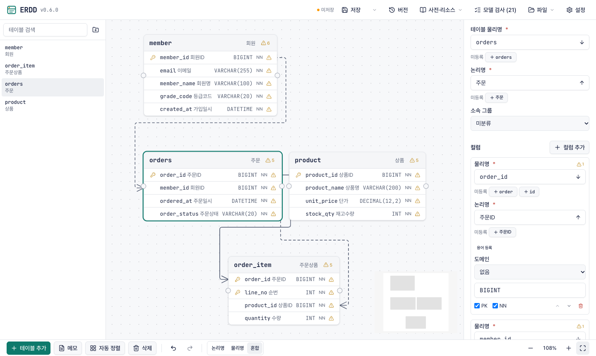

<!-- source: README.md @ v0.6.0 -->
<p align="center"><a href="README.md">English</a> | <b>한국어</b></p>

<h1 align="center">ERDD</h1>

<p align="center">실시간 협업 ERD 설계 도구 — 한국 실무 명명 체계(단어·용어·도메인 사전)와 CLI 연동</p>

<p align="center">
  <a href="https://www.npmjs.com/package/@erdd/cli"></a>
  <a href="https://github.com/jang2162/erdd/actions/workflows/ci.yml"></a>
  <a href="LICENSE"></a>
</p>

<p align="center">
  
</p>

## 소개

한국 팀의 데이터베이스 설계는 대개 승인된 단어·용어·도메인 사전과 테이블 정의서 같은 명명 표준에 기댑니다.
대부분의 ERD 도구는 그 표준을 다루지 않거나, 다이어그램을 코드와 멀리 떨어뜨려 둡니다.
ERDD 는 브라우저에서 함께 설계하는 동안 모든 이름을 사전에 맞춰 검사하고, CLI 는 스키마를 PR 과 AI
에이전트가 읽는 YAML 파일로 저장소에 둡니다. 팀이 함께 쓰는 서버(**서버 모드**)로도, 서버 없이 저장소
파일만으로(**로컬 모드**)도 쓸 수 있습니다. 관계형 스키마를 설계하고 명명 표준을 따르는 팀과 개발자를
위한 도구입니다.

> [!NOTE]
> 에디터 화면과 CLI 메시지는 현재 한국어로만 제공됩니다.

## 주요 기능

- 팀과 같은 ERD 를 실시간으로 함께 편집하고, 버전 이력·스냅샷·비교로 변경을 추적합니다.
- 물리명과 논리명을 입력하는 즉시 단어·용어·도메인 사전에 맞춰 검사합니다.
- 테이블 하나를 YAML 파일 하나로 두어, 스키마 변경이 PR diff 에서 그대로 읽힙니다.
- DDL·DBML·Excel 사전을 가져오고, DDL·DBML·이미지·Excel 정의서로 내보냅니다.
- AI 에이전트에 스킬 문서를 주어 `erdd` CLI 로 스키마를 편집하게 합니다.
- 로컬 모드에서는 계정도 DB 도 없이 혼자 쓰고, 이력은 git 으로 관리합니다.

## 설치

요구 사항: Node.js 22 이상, pnpm 또는 npm.

스키마를 둘 프로젝트에 CLI 를 설치하세요. 패키지가 원본 TypeScript 를 그대로 배포하므로 `tsx` 도 함께
선언합니다.

```bash
pnpm add -D @erdd/cli tsx
```

설치를 확인합니다.

```bash
pnpm exec erdd --version
```

```text
0.6.0
```

팀이 함께 쓸 서버를 세우려면 [설치·운영 매뉴얼](docs/manual/ko/install.md)을 보세요. 권장 방법은 Docker
Compose 와 PostgreSQL 17 을 씁니다.

## 빠른 시작

이 예제는 로컬 모드라 서버가 필요하지 않습니다.

1. 로컬 전용 프로젝트를 만듭니다.

   ```bash
   pnpm exec erdd init --local
   ```

   ```text
   로컬 전용 프로젝트를 만들었습니다. erdd serve로 여세요
   ```

2. 에디터를 엽니다.

   ```bash
   pnpm exec erdd serve
   ```

   ```text
   http://127.0.0.1:4300 에서 실행 중 (프로젝트: /path/to/your-project)
   중지하려면 Ctrl+C
   ```

   브라우저에 에디터가 열립니다. 화면의 편집은 **저장**(Cmd+S)을 눌러야 `erdd/` 아래 파일이 됩니다.

3. 저장한 뒤 모델을 검사하고 커밋합니다.

   ```bash
   pnpm exec erdd validate
   git add erdd erdd.config.yaml && git commit -m "Add schema"
   ```

   ```text
   정합성 문제 없음
   명명 경고 없음
   ```

## 문서

- [로컬 모드 매뉴얼](docs/manual/ko/local-guide.md): 서버 없이 혼자 쓰는 방법을 처음부터 끝까지 다룹니다
- [사용 매뉴얼](docs/manual/ko/user-guide.md): 브라우저 에디터 조작법
- [CLI 매뉴얼](docs/manual/ko/cli-guide.md): 명령 하나하나의 레퍼런스와 파일 포맷
- [설치·운영 매뉴얼](docs/manual/ko/install.md): ERDD 서버를 세우고 운영하는 방법

CLI 패키지는 공개 npm 의 [`@erdd/cli`](https://www.npmjs.com/package/@erdd/cli) 와
[`@erdd/core`](https://www.npmjs.com/package/@erdd/core) 입니다.

## 기여하기

이슈와 풀 리퀘스트를 환영합니다. 개발 문서는 한국어로 쓰여 있습니다. 변경 종류마다 어느 가이드를 봐야
하는지는 [AGENTS.md](AGENTS.md) 가 [docs/guides/](docs/guides/) 의 문서로 안내하니, 거기서 시작하세요.

## 라이선스

MIT License. 자세한 내용은 [LICENSE](LICENSE) 를 확인하세요.
